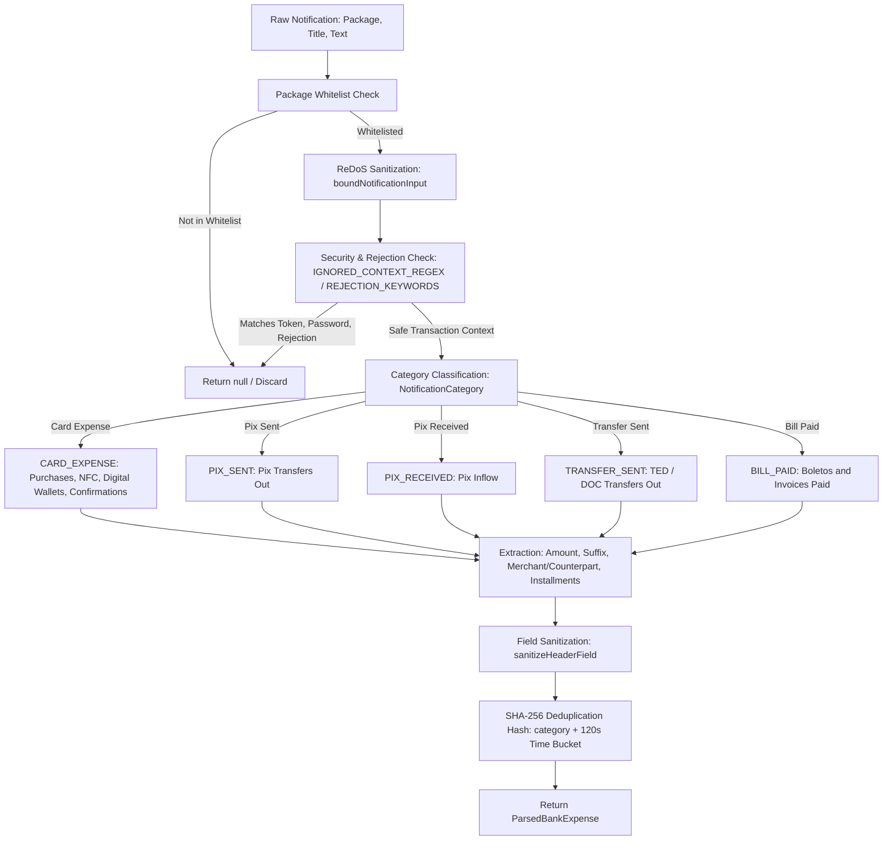

# Bank Notification Parser Skill

This skill guides adding and maintaining notification parsers in [BankNotificationParser.kt](../../../app/src/main/java/com/cardcontrol/app/service/BankNotificationParser.kt) and testing them in [SecurityAndDomainTestHarness.kt](../../../app/src/test/java/com/cardcontrol/app/SecurityAndDomainTestHarness.kt).

---

## 1. Core Architecture & Workflow

Every bank notification is processed through the following pipeline:



---

## 2. Step-by-Step Implementation Guide

### Step 1: Package Registration
Add package identifier to `SUPPORTED_PACKAGES`:
```kotlin
val SUPPORTED_PACKAGES = setOf(
    "com.nu.production",        // Nubank
    "br.com.intermedium",       // Inter
    "com.itau",                 // Itaú
    "com.itaucard.activity",    // Itaú Cartões
    "com.c6bank.app",           // C6 Bank
    "com.santander.app",        // Santander
    "br.com.santander.way",     // Santander Way
    "com.bradesco",             // Bradesco
    "br.com.bradesco.cartoes",  // Bradesco Cartões
    "br.gov.caixa.cartoes",     // Caixa Cartões
    "com.picpay",               // PicPay
    "com.mercadopago.wallet"    // Mercado Pago
)
```

### Step 2: Input Bounding (ReDoS Protection)
Always wrap incoming title and text:
```kotlin
val safeTitle = SecuritySanitizer.boundNotificationInput(title)
val safeText = SecuritySanitizer.boundNotificationInput(text)
```
*Never run unbounded regex on raw system strings.*

### Step 3: Filtering Non-Transaction Events and Rejections
- If the notification contains refund or rejection words (`"negada"`, `"recusada"`, `"estorno"`, `"estornada"`, `"cancelada"`), discard immediately by returning `null`.
- Ignore non-transactional system messages like 2FA tokens, temporary passwords, card delivery/activation alerts, or statements closed:
```kotlin
val IGNORED_CONTEXT_REGEX = Regex(
    """\b(c[oó]digo|token|senha\s+provis[oó]ria|seguran[çc]a|autentica[çc][aã]o|bloqueado|desbloqueado|fatura\s+fechada|limite\s+dispon[ií]vel|solicitado)\b""",
    RegexOption.IGNORE_CASE
)
```

### Step 4: Category Detection & Extraction Patterns
- **Category Classification:**
  Classified via regex triggers:
  - `CARD_EXPENSE`: Matches `"compra aprovada"`, `"aproximação"`, `"contactless"`, `"apple pay"`, `"samsung pay"`, `"você pagou"`, `"transação realizada"`.
  - `PIX_SENT`: Matches `"pix enviado"`, `"transferência enviada"`, `"realizou um pix"`, `"transferiu ... via pix"`.
  - `PIX_RECEIVED`: Matches `"pix recebido"`, `"transferência recebida"`, `"recebeu um pix"`, `"recebeu ... via pix"`.
  - `TRANSFER_SENT`: Matches `"ted enviada"`, `"transferência ... via ted"`.
  - `BILL_PAID`: Matches `"boleto pago"`, `"boleto liquidado"`, `"pagamento de boleto"`.
- **Amount (`AMOUNT_REGEX`):**
  Matches `R$ 1.250,50` or `R$ 49,90`.
  Replace dots and convert comma to dot (`toDoubleOrNull()`). Verify amount `> 0.0` and `<= 1_000_000.0`. Canonical representation is in cents (`Long`).
- **Card Suffix (`LAST_FOUR_REGEX`):**
  Matches `final 1234` or `cartão ****1234`. Nullable for Pix and boletos.
- **Counterpart Extraction (`RECIPIENT_REGEX` and `SENDER_REGEX`):**
  Matches destination recipient (`para <Nome>`) or origin sender (`de <Nome>`) for Pix and transfers, with lookahead protecting against trailing punctuation (`Dra Camila.`, `João Silva,`).
- **Installments (`INSTALLMENTS_REGEX`):**
  Matches `em 3x` or `10x`. Validate with `SecuritySanitizer.validateInstallments(raw)`. Default is `1`.
- **Merchant (`MERCHANT_REGEX`):**
  Extract establishment name. Always sanitize with `SecuritySanitizer.sanitizeHeaderField(rawMerchant, maxLength = 40)`.

### Step 5: SHA-256 Deduplication Hashing
Banks frequently emit multiple push notifications for a single transaction. CardControl deduplicates transactions using a 2-minute (120s) bucket and includes the category to prevent cross-category collision:
```kotlin
val timeBucket = timestamp / 120_000L
val target = counterpart ?: merchant ?: "transacao"
val hashInput = "$packageName|${category.name}|${lastFour ?: "0000"}|$cleanAmount|${target.lowercase()}|$timeBucket"
val dedupHash = sha256(hashInput)
```

---

## 3. Mandatory Unit Testing

Whenever a parser pattern is added or updated, add test methods in `SecurityAndDomainTestHarness.kt`:

1. **Positive case:** Valid push notification matches expected amount, merchant, and installments.
2. **Declined/Canceled case:** Notification with "negada" or "estorno" must return `null`.
3. **Spoofing case:** Unofficial package (e.g., `com.whatsapp`) with identical text must return `null`.
4. **Boundary case:** Odd installment division or massive string inputs.

Run validation:
```powershell
powershell -ExecutionPolicy Bypass -File .agents/skills/cardcontrol-verify/scripts/verify.ps1 -TestsOnly
```
